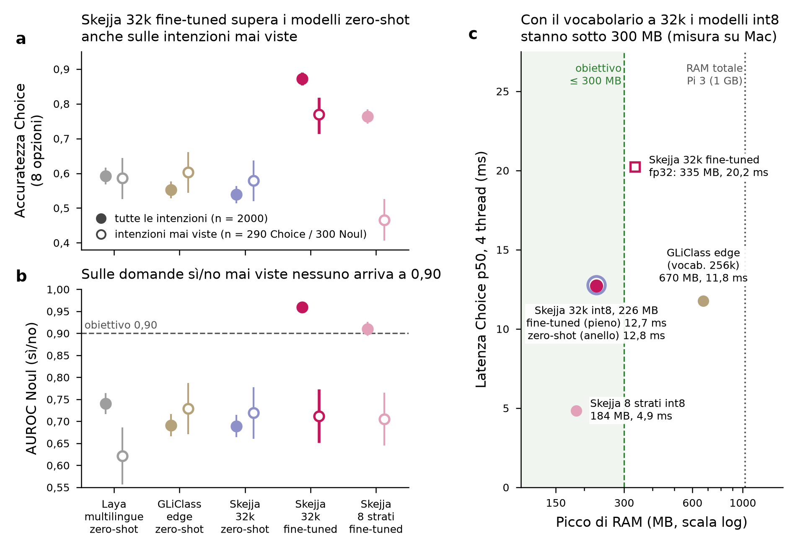

# Skejja — Report fase 1: un System One multilingue per Raspberry Pi

_4 ottobre 2026; verdetto aggiornato il 6 ottobre 2026 con le misure sul Raspberry Pi 3 ([results/pi3/ANALISI.md](../results/pi3/ANALISI.md)). Tutti i numeri vengono da codice eseguito. Dove non è indicato il Pi 3, latenza e RAM sono misurate su Mac (Apple Silicon)._

## Verdetto

**Si va avanti: il funzionamento su hardware modesto è confermato sul Raspberry Pi 3.** La fase 1 è chiusa; Pi 4 e Pi 5 si misurano in parallelo alla fase 2.

**Sul Raspberry Pi 3** (1 GB di RAM, CPU senza dot-product), con la variante int8 dinamica consigliata per questo tipo di CPU:

- il modello ha **la stessa qualità del Mac**: accuratezza e AUROC identici sulle stesse 500 domande;
- usa **197 MB di RAM** (22 strati) e **166 MB** (8 strati), sotto l'obiettivo di 300 MB;
- **su un solo core**, senza sottotensione: domanda sì/no in **111 ms** e Choice a 8 opzioni in **343 ms** con 8 strati; 288 ms e 908 ms con 22 strati. Con 4 core è più veloce di almeno 1,5–2,4 volte; il valore esatto non è ancora misurato perché l'alimentazione non reggeva.

**Sull'intero test** (misure su Mac, identiche al Pi), il candidato principale (`Skejja 32k fine-tuned`):

- ha un'accuratezza Choice di **0,873** sull'intero test, contro 0,593 di Laya multilingue e 0,552 di GLiClass edge, nelle loro versioni quantizzate;
- anche sulle **intenzioni mai viste in addestramento**, il confronto equo con i modelli zero-shot, arriva a **0,769** contro 0,586 (Laya) e 0,603 (GLiClass);
- ha un divario fra l'inglese e la lingua peggiore di **4,0 punti** (Laya 11,5, GLiClass 16,7);
- nella variante int8 dinamica usata sul Pi resta molto sopra le baseline: Choice **0,853** (0,735 sulle mai viste), AUROC sì/no **0,940**.

**Cosa non è ancora validato:** i tempi su Pi 4 e Pi 5. Finché non li misuriamo non scriviamo tempi per quelle schede; la formula corretta è "funziona su Raspberry Pi 3 e successivi; tempi misurati su Pi 3". Sul Pi 5, che ha le istruzioni dot-product, la variante più veloce potrebbe essere l'int8 "solo pesi": il runtime la sceglie da solo, ma non è ancora verificato.

**Punto debole:** le domande sì/no (Noul) su intenzioni mai viste. L'AUROC è 0,712 e la calibrazione è pessima (ECE 0,211). Il fine-tuning non le ha migliorate: va affrontato nella fase 2.

La regola di stop fissata prima di partire (*nessun candidato piccolo sotto 300 MB e entro 3 punti da Laya*) **non scatta**.

_Figura. (a) Accuratezza Choice con 8 opzioni (il caso darebbe 0,125): punti pieni = tutte le 2000 domande, punti vuoti = le 290 su intenzioni dei 4 ambiti esclusi dall'addestramento (transport, takeaway, social, cooking); barre = intervallo di Wilson al 95%. (b) AUROC delle domande sì/no, 2000 domande / 300 mai viste; barre = intervallo al 95% approssimato con Hanley-McNeil. Versioni quantizzate come andrebbero in produzione: Laya e GLiClass `onnx-w8e4a4`, Skejja `onnx-int8` weight-only. (c) Picco di RAM e latenza mediana di una decisione Choice, misurati sul Mac con il runner del kit Raspberry (onnxruntime + tokenizers + numpy, un processo nuovo per ogni modello). Laya non compare perché non è nel kit: con l'harness di misura arriva a circa 1,3 GB, troppo per un Pi 3._

## Cosa è stato misurato

- **Benchmark:** MASSIVE (Amazon, CC BY 4.0) in inglese, italiano, spagnolo, tedesco e francese. Le stesse 400 frasi nelle 5 lingue, per un totale di 2000 domande Choice (8 opzioni: la risposta giusta, fino a 3 distrattori dello stesso ambito e altri casuali) e 2000 domande Noul ("Does the user want to …?"). La calibrazione è stata fatta su 1500+1500 domande del set di validazione, separate dal test. Le frasi sono brevi (mediana 6 parole), come i comandi vocali.
- **Modelli di partenza (zero-shot):** Laya multilingue (mmBERT-base, 322M parametri) e GLiClass multilang edge (mmBERT-small, 143M parametri), entrambi Apache-2.0.
- **Candidati piccoli** costruiti a partire da GLiClass edge:
  1. vocabolario ridotto da 256.003 a 32.768 token, scelti sulle 5 lingue usando frasi MASSIVE di addestramento e Wikipedia, senza mai vedere il test;
  2. fine-tuning sulle frasi di addestramento delle **49 intenzioni "viste"**; i 4 ambiti esclusi (10 intenzioni) non sono mai stati usati né come frasi né come opzioni;
  3. uno "studente" a 8 strati distillato dal modello fine-tuned.
- **Protocollo comune** (`skejja_measure.py`): calibrazione con temperatura per Choice e Platt per Noul, fittata solo sul set di calibrazione; ECE a 15 intervalli; latenza di una decisione per chiamata, con 1 e 4 thread e almeno 300 chiamate dopo il riscaldamento.

## Tabella di confronto

Fonte: [skejja_fase1_confronto.csv](../results/fase1/skejja_fase1_confronto.csv). "Mai viste" = intenzioni dei 4 ambiti esclusi dall'addestramento.

| | Laya multilingue | GLiClass edge | Skejja 32k zero-shot | **Skejja 32k fine-tuned** | Skejja 8 strati fine-tuned |
|---|---|---|---|---|---|
| Choice, accuratezza (tutte) | 0,593 | 0,552 | 0,538 | **0,873** | 0,764 |
| Choice, accuratezza (mai viste) | 0,586 | 0,603 | 0,579 | **0,769** | 0,466 |
| Divario EN − lingua peggiore | 0,115 | 0,167 | 0,158 | **0,040** | 0,052 |
| Choice ECE calibrato (tutte / mai viste) | 0,048 / 0,081 | 0,037 / 0,067 | 0,031 / 0,105 | 0,024 / 0,073 | 0,030 / 0,115 |
| Noul AUROC (tutte / mai viste) | 0,740 / 0,621 | 0,691 / 0,729 | 0,689 / 0,719 | 0,959 / **0,712** | 0,910 / 0,705 |
| Noul ECE calibrato (tutte / mai viste) | 0,020 / 0,112 | 0,045 / 0,060 | 0,046 / 0,058 | 0,026 / **0,211** | 0,036 / 0,156 |
| Latenza Choice p50, 4 thread, runner kit (Mac) | — | 11,8 ms | 12,8 ms | 12,7 ms | 4,9 ms |
| Latenza Choice p50, 1 thread, runner kit (Mac) | — | 29,5 ms | 31,7 ms | 31,4 ms | 12,1 ms |
| Picco RAM, runner kit (Mac) | — | 670 MB | 226 MB | **226 MB** | 184 MB |
| Picco RAM, harness di misura* | 1330 MB | 833 MB | 345 MB | 350 MB | 302 MB |
| Pesi su disco | 266 MB | 110 MB | 101 MB | 101 MB | 71 MB |

\* L'harness carica anche scipy e sklearn (circa 150 MB in più). È utile per confrontare i modelli fra loro, non per stimare il consumo reale.

## Criteri di successo (candidato principale, Skejja 32k fine-tuned int8)

| Criterio (fissato prima) | Risultato | Esito |
|---|---|---|
| Latenza p50 ≤ 200 ms su Pi 5 / ≤ 400 ms su Pi 4 (sul Pi 3 solo da registrare) | Pi 3, 1 core, int8 dinamico: Choice 908 ms, sì/no 288 ms (22 strati); 343 e 111 ms (8 strati) | Pi 3 registrato; **Pi 4 raggiunto** (9 ottobre, candidato fase 2 ft5, int8 dinamico: Choice 379 ms a 1 thread, 170 ms a 4; [results/pi4/ANALISI.md](../results/pi4/ANALISI.md)); Pi 5 da misurare |
| Picco RAM ≤ 300 MB | 197 MB sul Pi 3 (int8 dinamico, 22 strati); tutte le int8 a 32k fra 166 e 201 MB | **superato sul Pi 3** |
| Choice entro 3 punti da Laya o meglio | +28 punti (tutte), +18 (mai viste) | superato |
| Divario lingua peggiore ≤ 8 punti | 4,0 punti | superato |
| ECE dopo calibrazione ≤ 0,05 | Choice 0,024 / Noul 0,026; ma mai viste 0,073 / 0,211 | **superato solo sulle intenzioni viste** |
| Noul AUROC ≥ 0,90 | 0,959 tutte; 0,712 mai viste | **superato solo sulle intenzioni viste** |

## Cosa abbiamo imparato

1. **Il vocabolario è la chiave della RAM.** In GLiClass edge la tabella del vocabolario pesa 98M dei 143M parametri. Ridurla a 32k token porta il modello a 57M parametri, con una perdita in zero-shot quasi nulla (0,5475 → 0,5415 in fp32). Il 98,3% dei token del test resta coperto e il 90% delle frasi si tokenizza in modo identico. Sulle frasi completamente coperte il modello ridotto dà gli stessi risultati dell'originale (differenza massima sui logit 2,2·10⁻⁵).
2. **Anche il tokenizer pesa sulla RAM.** Caricare il file del tokenizer da 256k token occupa da solo circa 410–430 MB. Con il vocabolario a 32k il problema sparisce.
3. **L'int8 standard di onnxruntime peggiora i modelli**, come segnalato da laya-pi. Choice: Laya −5 punti, GLiClass −10 punti. La quantizzazione "solo pesi" a 8 bit (MatMulNBits) mantiene quasi tutta la qualità ed è quella usata qui.
4. **Il fine-tuning sullo stesso dominio aiuta anche le intenzioni mai viste nella scelta fra opzioni** (+19 punti rispetto al modello ridotto non addestrato: 0,579 → 0,769), **ma non le domande sì/no**: su quelle l'AUROC resta intorno a 0,71 e la calibrazione peggiora.
5. **Lo studente a 8 strati è 2,6 volte più veloce ma nella scelta fra opzioni perde la generalizzazione** (0,466 sulle intenzioni mai viste, sotto il modello senza addestramento); sulle sì/no mai viste resta al livello degli altri (AUROC 0,705). Va bene per un ambito fisso, non per un modello generico.

6. **Sul Raspberry la quantizzazione giusta dipende dalla CPU.** Sui processori senza istruzioni dot-product (Pi 3 e Pi 4) l'int8 "solo pesi", il più veloce sul Mac, è il più lento: a 22 strati e 1 thread la Choice impiega 2.336 ms contro 908 ms dell'int8 dinamico. Il runtime ora sceglie da solo l'int8 dinamico su queste CPU.

## Limiti (da leggere prima di citare i numeri)

- **Latenza misurata solo sul Pi 3, e pulita solo a 1 thread.** A 4 thread l'alimentazione andava in sottotensione, quindi abbiamo solo un limite superiore. Pi 4 e Pi 5 non sono ancora misurati; sul Pi 5 (con dot-product) la variante più veloce potrebbe essere diversa.
- **"Mai viste" significa intenzioni nuove dentro lo stesso dominio** (assistente vocale MASSIVE), non domini nuovi. Serve un test fuori dominio.
- **Il campione "mai viste" è piccolo** (290 Choice / 300 Noul): intervallo al 95% di circa ±5 punti sul totale e circa ±11 punti per singola lingua (58 domande).
- **Le opzioni sono descrizioni in inglese per tutte le lingue** (scenario cross-lingua); le opzioni scritte in italiano non sono state testate.
- **La primitiva Score non è stata misurata** in questa fase.
- **Fine-tuning limitato:** 20.000 esempi Choice e 20.000 Noul (0,42 epoche), una sola esecuzione, nessuna ricerca degli iperparametri. Il teacher per la distillazione era GLiClass edge, non Laya.
- **Possibile contaminazione dei modelli di partenza non verificabile:** le model card citano MASSIVE come set di valutazione, non di addestramento.
- **Laya non è stato confrontato nel runner del kit**: il suo fp32 ONNX pesa 1,3 GB e su un Pi 3 non è eseguibile.

## Prossimi passi

1. **Correggere le domande sì/no su intenzioni nuove:** dati Noul più vari e multilingue anche fuori da MASSIVE, negativi difficili, calibrazione per famiglia di domande; tenere sempre ambiti esclusi per misurare.
3. **Test fuori dominio** (smistamento email, controlli sugli agenti, domotica reale) per verificare che il modello non abbia imparato solo MASSIVE.
4. **Opzioni in italiano** e primitiva **Score**.
5. **Choice più veloci:** quando le opzioni sono fisse, codificarle una volta sola (architettura che separa testo e opzioni) o accorciarne le descrizioni.
6. **In parallelo:** misure su Pi 4 e Pi 5 con lo stesso kit, e un giro a 4 thread sul Pi 3 con un alimentatore adeguato.

## File

- `skejja-pi-kit.tar.gz` (file di release, non versionato in git; ricostruibile con `kit/make_kit.sh`): kit per il Raspberry (7 varianti ONNX, dati di test, `bench_pi.py`, `run_pi.sh`, istruzioni in italiano).
- [skejja_fase1_confronto.csv](../results/fase1/skejja_fase1_confronto.csv): tabella di confronto.
- [skejja_fase1_metrics_all.csv](../results/fase1/skejja_fase1_metrics_all.csv): tutte le metriche in formato lungo (8.758 righe).
- [mac_reference_kit_run.json](../results/fase1/mac_reference_kit_run.json): riferimento Mac del runner del kit, da confrontare con il Pi.
- Note di metodo: [baseline](methods_baseline.md), [modelli piccoli](methods_modelli_piccoli.md).
- Benchmark: [test_choice.jsonl](../bench/data/test_choice.jsonl), [test_noul.jsonl](../bench/data/test_noul.jsonl), [success_criteria.json](../bench/success_criteria.json), [skejja_measure.py](../bench/skejja_measure.py).
