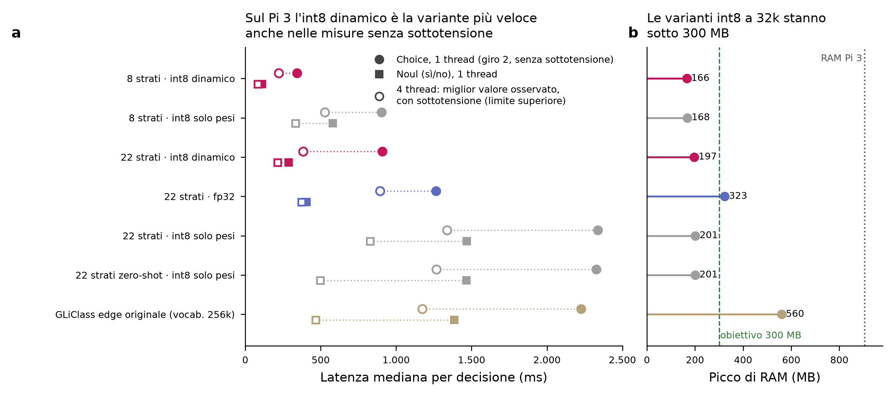

# Analisi delle misure sul Raspberry Pi 3 — giri 1, 2 e 3

_File analizzati: `pi3_20261005-120245.json` (giro 1), `pi3_20261006-111423.json` (giro 2), `pi3_20261008-093657.json` (giro 3, fase 2) e, per le stesse 500 domande sul Mac, `mac_parity_subset500.json` (fase 1) e `mac_parity_ft5_subset500.json` (ft5)._

_Il giro 3 (ft5, candidato della fase 2) è nella sezione [Giro 3](#giro-3-ft5-contro-ft32k-8-ottobre); le sezioni seguenti riguardano i giri 1 e 2._

## Quanto sono affidabili le misure

- **Giro 1 (5 ottobre):** sottotensione per tutto il giro, controllata a mano (vedi `README.md`). Tutte le latenze sono pessimistiche.
- **Giro 2 (6 ottobre, alimentatore da 20 W):** segnato `"throttled": true` (169 campioni su 353 con i bit 0x1 o 0x4 attivi). Dividendo i campioni per modello e per fase si vede però che:
  - **con 1 thread le fasi di misura della latenza sono pulite**: nessun campione in sottotensione durante le Choice e le sì/no di nessun modello. I pochi campioni cattivi a 1 thread cadono all'inizio del modello e sono uno strascico del giro a 4 thread precedente;
  - **con 4 thread quasi tutte le fasi sono in sottotensione.**
- **Conferma indiretta:** a 1 thread le latenze del giro 2 coincidono con quelle del giro 1 entro l'1,3%. A 1 thread anche il giro 1 era quindi, in pratica, pulito.
- **Qualità e RAM** sono identiche nei due giri (qualità uguale alla terza cifra, RAM entro 3 MB) e non dipendono dall'alimentazione.

**Quindi:** le latenze **a 1 thread** sono misure valide. Per i **4 thread** abbiamo solo un limite superiore: il miglior valore osservato nei due giri, misurato comunque con la CPU rallentata.

Campioni di `get_throttled` in sottotensione, giro 2. Le colonne "fasi" contano i campioni che cadono nelle fasi di misura della latenza (Choice · sì/no). Le fasi sono ricostruite dai tempi mediani, quindi i confini sono approssimati di pochi secondi.

| Variante | 1 thread, tutto il modello | 1 thread, fasi | 4 thread, tutto il modello | 4 thread, fasi |
|---|---|---|---|---|
| 8 strati · int8 dinamico | 1/6 | 0/2 · 0/1 | 5/9 | 0/1 · 1/1 |
| 8 strati · int8 solo pesi | 0/12 | 0/6 · 0/4 | 21/22 | 4/4 · 2/2 |
| 22 strati · int8 dinamico | 0/11 | 0/6 · 0/2 | 5/18 | 1/3 · 1/1 |
| 22 strati · fp32 | 0/14 | 0/8 · 0/3 | 31/33 | 5/5 · 3/3 |
| 22 strati · int8 solo pesi | 1/28 | 0/15 · 0/10 | 49/53 | 8/9 · 5/5 |
| 22 strati zero-shot · int8 solo pesi | 0/29 | 0/16 · 0/9 | 23/44 | 7/9 · 0/3 |
| GLiClass edge originale (vocab. 256k) | 1/27 | 0/15 · 0/9 | 32/45 | 5/8 · 1/3 |

## Giro 3: ft5 contro ft32k (8 ottobre)

Kit `skejja-pi-kit-fase2`, comando `./run_pi.sh --models ft5-int8dyn,ft5-int8`, stesso Pi, alimentatore e cavo del giro 2. ft5 ha la stessa architettura di ft32k (22 strati, vocabolario 32k). L'unica differenza nei file per il Pi è che l'int8 dinamico di ft5 lascia in fp32 la proiezione d'uscita dell'MLP (`mlp.Wo`): con la quantizzazione completa ft5 perdeva 9 punti di Choice sulle intenzioni mai viste ([docs/fase2_agente.md](../../docs/fase2_agente.md#quantizzazione-per-il-raspberry-ft5)).

**Affidabilità.** Il giro è segnato `"throttled": true` (80 campioni su 123), con lo stesso schema del giro 2:
- **a 1 thread** nessun campione in sottotensione nelle fasi di misura (Choice · sì/no): ft5-int8dyn 0/7 · 0/2, ft5-int8 0/17 · 0/11. Le latenze a 1 thread sono valide e confrontabili con il giro 2;
- **a 4 thread** quasi tutte le fasi sono in sottotensione (ft5-int8dyn 5/5 · 2/2, ft5-int8 9/10 · 6/6). Nel giro 2, per ft32k-int8dyn, era sporca solo una parte delle fasi (1/3 · 1/1). Le latenze a 4 thread **non sono confrontabili** fra i due giri;
- **qualità e RAM** non dipendono dall'alimentazione.

Latenza = tokenizzazione + modello, mediana (p95), 200 decisioni per tipo, 1 thread. Qualità sulle stesse 500 domande del giro 2.

| Variante | Choice (ms) | Sì/no (ms) | Picco RAM 1 / 4 thread (MB) | Caricamento (s) | Accuratezza Choice Pi / Mac | ECE Choice calibrata | AUROC sì/no Pi / Mac | Accuratezza sì/no |
|---|---|---|---|---|---|---|---|---|
| ft32k · int8 dinamico (giro 2) | 908 (1.059) | 288 (422) | 186 / 197 | 9,5 | 0,848 / 0,848 | 0,038 | 0,941 / 0,941 | 0,856 |
| **ft5 · int8 dinamico, `mlp.Wo` in fp32** | **991 (1.155)** | **322 (467)** | **215 / 226** | 8,9 | 0,848 / 0,848 | 0,063 | **0,973 / 0,973** | 0,918 |
| ft32k · int8 solo pesi (giro 2) | 2.336 (2.559) | 1.469 (1.675) | 188 / 201 | 7,3 | 0,858 / 0,860 | 0,035 | 0,962 / 0,962 | 0,906 |
| ft5 · int8 solo pesi | 2.371 (2.595) | 1.505 (1.711) | 188 / 200 | 7,0 | 0,854 / 0,856 | 0,052 | 0,973 / 0,973 | 0,918 |

### Cosa ci dice il giro 3

1. **Il costo di `mlp.Wo` in fp32 è quello previsto.** Con l'int8 dinamico ft5 è più lento del 9,1% sulle Choice (991 contro 908 ms) e dell'11,7% sulle sì/no (322 contro 288 ms). La stima fatta prima del giro era circa 990 ms. Una parte del divario non dipende dal modello: con l'int8 solo pesi, dove ft5 e ft32k hanno grafi identici, ft5 risulta comunque più lento dell'1,5–2,4%. È la variazione fra un giorno e l'altro (temperatura, stato della scheda). Il costo netto di `mlp.Wo` è quindi **circa +7–9%**.
2. **RAM: +29 MB, sempre sotto i 300 MB.** 215 MB a 1 thread, 226 MB a 4. I 29 MB in più corrispondono esattamente ai pesi di `mlp.Wo` tenuti in fp32 invece che in int8: 22 strati × 384 × 1.152 pesi × 3 byte in più per peso ≈ 29 MB. Con l'int8 solo pesi la RAM è identica a ft32k (188 MB).
3. **Il Pi dà le stesse risposte del Mac anche con ft5.** Con l'int8 dinamico accuratezza e AUROC coincidono; con l'int8 solo pesi la differenza è di una domanda su 500, come nel giro 2.
4. **Qualità: sulle sì/no ft5 è nettamente migliore, sulle Choice è uguale.** Sulle 500 domande l'AUROC sì/no sale da 0,941 a 0,973 e l'accuratezza da 0,856 a 0,918. L'accuratezza Choice resta 0,848. Su queste 500 domande solo 40 Choice e 55 sì/no riguardano intenzioni mai viste; per quelle valgono le misure sul test completo della fase 2 (Choice 0,724 per ft5 contro 0,735 per ft32k int8 dinamico).
5. **Per lingua le 500 domande non bastano.** Qui ft5 ha 0,91 in inglese e 0,82–0,84 nelle altre lingue, contro 0,83–0,87 di ft32k, ma con 100 domande per lingua l'intervallo è di circa ±0,07. Sul test completo (2000 domande, Mac, stesso file int8 dinamico) il divario fra l'inglese e la lingua peggiore di ft5 è di 3,3 punti (en 0,890, de 0,858), contro 5,0 di ft in fp32 e 5,8 di ft3 in int8 dinamico ([metrics_edge32k-ft5_int8dyn-noWo.csv](../fase2/metrics_edge32k-ft5_int8dyn-noWo.csv)): lo squilibrio visto sul Pi è dovuto al campione.
6. **Da guardare: la calibrazione delle Choice di ft5 è peggiore.** ECE calibrata 0,063 sulle 500 domande (Pi e Mac uguali). Non è rumore del campione: sul test completo, sul Mac, è 0,047 per l'int8 dinamico e 0,050 per fp32, contro 0,027 di ft e 0,022 di ft3 ([metrics_edge32k-ft5.csv](../fase2/metrics_edge32k-ft5.csv), [metrics_edge32k-ft5_int8dyn-noWo.csv](../fase2/metrics_edge32k-ft5_int8dyn-noWo.csv)). È al limite dell'obiettivo (≤ 0,05). La sola temperatura non basta: va provata una calibrazione più ricca per le Choice (per esempio temperatura per lingua o Platt sulle probabilità delle opzioni).
7. **I 4 thread restano non misurati.** Il valore di ft5-int8dyn a 4 thread (678 ms) è peggiore di quello di ft32k nel giro 2 (383 ms) solo perché questa volta tutte le fasi erano in sottotensione. Non va usato.

## Risultati (giri 1 e 2, fase 1)

Pi 3 Model B Rev 1.2, Debian 13 a 64 bit, 905 MB di RAM, onnxruntime 1.30.0, CPU senza istruzioni dot-product. Latenza = tokenizzazione + modello per una decisione: mediana, p95 tra parentesi, 200 decisioni per tipo. Qualità sulle prime 500 domande del test (100 frasi × 5 lingue), uguali su Pi e Mac.

| Variante | Choice, 1 thread (ms) | Sì/no, 1 thread (ms) | Choice, 4 thread: limite superiore (ms) | Sì/no, 4 thread: limite superiore (ms) | Picco RAM (MB) | Caricamento (s) | Accuratezza Choice Pi / Mac | AUROC sì/no Pi / Mac |
|---|---|---|---|---|---|---|---|---|
| 8 strati · int8 dinamico | 343 (402) | 111 (160) | 223 | 84 | 166 | 2,9 | 0,742 / 0,742 | 0,894 / 0,894 |
| 8 strati · int8 solo pesi | 904 (991) | 579 (659) | 527 | 332 | 168 | 2,5 | 0,754 / 0,754 | 0,898 / 0,897 |
| 22 strati · int8 dinamico | 908 (1.059) | 288 (422) | 383 | 213 | 197 | 7,7 | 0,848 / 0,848 | 0,941 / 0,941 |
| 22 strati · fp32 | 1.265 (1.487) | 407 (612) | 892 | 374 | 323 | 8,1 | 0,860 / 0,860 | 0,962 / 0,962 |
| 22 strati · int8 solo pesi | 2.336 (2.559) | 1.469 (1.675) | 1.338 | 828 | 201 | 7,0 | 0,858 / 0,860 | 0,962 / 0,962 |
| 22 strati zero-shot · int8 solo pesi | 2.326 (2.553) | 1.466 (1.671) | 1.267 | 497 | 201 | 7,0 | 0,546 / 0,556 | 0,669 / 0,666 |
| GLiClass edge originale (vocab. 256k) | 2.225 (2.470) | 1.386 (1.593) | 1.172 | 467 | 560 | 16,0 | 0,536 / 0,532 | 0,677 / 0,675 |

## Cosa ci dicono

1. **Il Pi dà le stesse risposte del Mac.** fp32 e int8 dinamico producono accuratezza e AUROC identici. Le varianti int8 "solo pesi" differiscono al massimo di 1 punto (5 domande su 500 per lo zero-shot), perché senza dot-product onnxruntime usa un percorso di calcolo diverso. La qualità misurata nella fase 1 vale anche sul Pi.
2. **La RAM è risolta.** Le varianti int8 con vocabolario a 32k usano fra 166 e 201 MB, sotto l'obiettivo di 300 MB; la versione fp32 lo supera (323 MB). GLiClass edge originale arriva a 560 MB: la riduzione del vocabolario fa risparmiare circa 360 MB sul dispositivo.
3. **Sul Pi la variante giusta è l'int8 dinamico, ora confermato da misure pulite.** Con 1 thread, per il modello a 22 strati, la Choice richiede 908 ms con l'int8 dinamico, 1.265 ms con l'fp32 e 2.336 ms con l'int8 "solo pesi", che sul Mac era il più veloce: l'int8 dinamico è 2,6 volte più rapido. Con 8 strati: 343 ms contro 904 ms. Il prezzo in qualità rispetto all'fp32 è piccolo: accuratezza 0,848 contro 0,860, AUROC 0,941 contro 0,962.
4. **Con l'int8 dinamico, le sì/no costano circa un terzo delle Choice:** con 1 thread 288 ms (22 strati) e **111 ms** (8 strati). La Choice è più lenta perché nell'ingresso entrano le 8 descrizioni delle opzioni (mediana 50 token).
5. **Il guadagno dei 4 thread non è ancora misurabile, ma è maggiore di quanto sembrava.** Nel giro 1 avevo scritto "da 1,4 a 1,8 volte": quel rapporto era falsato dalla sottotensione, che rallentava soprattutto i 4 thread. Ora possiamo dare solo un limite inferiore. Per l'int8 dinamico a 22 strati la Choice passa da 908 ms (1 thread, pulito) a 383 ms o meno (4 thread), cioè **almeno 2,4 volte** più veloce; a 8 strati almeno 1,5 volte. I valori veri a 4 thread si avranno solo senza sottotensione.
6. **L'alimentazione regge un core, non quattro.** Neanche l'alimentatore da 20 W ha evitato la sottotensione sotto carico pieno. È probabile che la tensione cali nel cavo o nell'adattatore USB-C → micro-USB; con l'alimentatore ufficiale micro-USB del Pi 3 (5,1 V, 2,5 A, cavo integrato) il problema dovrebbe sparire, ma va verificato.
7. **Il caricamento richiede secondi** (7,7 s per il modello a 22 strati, 2,9 s per quello a 8): il modello va caricato una volta all'avvio del servizio, non a ogni richiesta.

## Rispetto agli obiettivi

- **RAM ≤ 300 MB:** raggiunto sul Pi 3 da tutte le varianti int8 a 32k, compreso ft5 con `mlp.Wo` in fp32 (215–226 MB).
- **Latenza:** per il Pi 3 l'obiettivo era solo da registrare. Su **un solo core**, senza sottotensione, il modello a 8 strati risponde a una sì/no in 111 ms e a una Choice in 343 ms; quello a 22 strati in 288 e 908 ms; ft5, candidato della fase 2, in 322 e 991 ms. Con 4 core sarà più veloce di almeno 1,5–2,4 volte. Per gli obiettivi su Pi 4 (≤ 400 ms) e Pi 5 (≤ 200 ms) servono le misure su quei dispositivi.

## Prossimi passi

1. **Giro 4 sul Pi 3 solo a 4 thread** (`./run_pi.sh --models ft5-int8dyn,ft32k-int8dyn,L8-int8dyn --threads 4`) con l'alimentatore ufficiale micro-USB (5,1 V, 2,5 A, cavo integrato), accettato solo se `get_throttled` resta `0x0` per tutto il giro. I numeri a 1 thread ci sono già, anche per ft5. Senza un alimentatore diverso un altro giro a 4 thread non serve: i giri 2 e 3 mostrano che con l'alimentatore attuale i 4 core vanno in sottotensione.
2. **Misure sul Pi 4**, con lo stesso kit.
3. **Calibrazione delle Choice di ft5** (ECE 0,047–0,063, vedi punto 6 del giro 3).
4. **In `bench_pi.py`, registrare `get_throttled` anche all'inizio e alla fine di ogni fase** (latenza Choice, latenza sì/no, qualità), così l'attribuzione è esatta invece che ricostruita dai tempi.
5. **Idea per la fase 2: rendere le Choice veloci quanto le sì/no.** Quando le opzioni sono sempre le stesse (per esempio i comandi di casa), si possono codificare una volta sola con un'architettura che separa testo e opzioni; altrimenti si possono accorciare le descrizioni.
