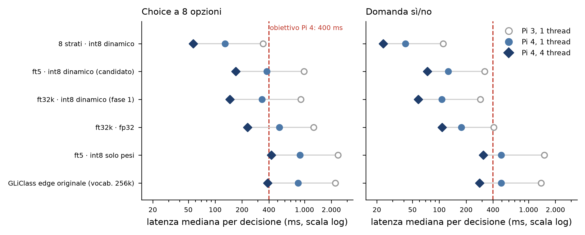

# Analisi delle misure sul Raspberry Pi 4 — giro 1

_File analizzati: `pi4_20261009-115526.json` (Pi 4), `../pi3/pi3_20261006-111423.json` e `../pi3/pi3_20261008-093657.json` (Pi 3, giri 2 e 3), `../pi3/mac_parity_subset500.json` e `../pi3/mac_parity_ft5_subset500.json` (stesse 500 domande sul Mac)._

**Sintesi.** Sul Pi 4 il candidato ft5, con l'int8 dinamico, **raggiunge l'obiettivo di 400 ms**: una Choice a 8 opzioni richiede 379 ms con un solo core e 170 ms con quattro; una sì/no 126 e 74 ms. Con 4 thread è sotto anche l'obiettivo previsto per il Pi 5 (200 ms). RAM 216–227 MB. Le risposte coincidono con quelle del Pi 3 e del Mac.

## Quanto sono affidabili le misure

- **Alimentazione pulita:** nessun campione su 190 con i bit di sottotensione o rallentamento (0x1, 0x4). È il primo giro senza sottotensione, quindi **anche le latenze a 4 thread sono misure valide**, non limiti superiori come sul Pi 3.
- **Temperatura al limite a 4 thread** (scheda senza dissipatore né ventola): il limite di temperatura (bit 0x8) è attivo in 2–5 campioni per modello, ma **sempre durante la fase di qualità**, mai durante le fasi di latenza (Choice e sì/no: 0 campioni su 0–3 per fase, per tutti i modelli). Le fasi sono ricostruite dai tempi mediani, come per il Pi 3.
- **Rallentamento finale:** i bit storici 0x20000 e 0x40000 compaiono fra i campioni a t = 4.531 e 4.561 s, durante la fase di qualità di `ft5-int8dyn` a 4 thread (iniziata a circa t = 4.447 s). Le latenze di quel modello erano già state misurate.
- **onnxruntime 1.31.0** sul Pi 4, contro 1.30.0 sul Pi 3: il rapporto fra le due schede include anche il cambio di versione.
- **Qualità e RAM** non dipendono da temperatura e alimentazione.

_Figura. Latenza mediana di una decisione (tokenizzazione + modello, 200 decisioni per tipo) sul Pi 4 a 1 e 4 thread e sul Pi 3 a 1 thread (giro 2; ft5 giro 3). La linea tratteggiata è l'obiettivo per il Pi 4. Scala logaritmica._

## Risultati

Pi 4 Model B Rev 1.5, 4 GB, Debian 13 a 64 bit, CPU senza dot-product. Latenza = mediana (p95 tra parentesi), 200 decisioni per tipo. Qualità sulle prime 500 domande del test (100 frasi × 5 lingue), misurata nel giro a 4 thread.

| Variante | Choice 1 thread (ms) | Sì/no 1 thread (ms) | Choice 4 thread (ms) | Sì/no 4 thread (ms) | Picco RAM 1 / 4 thread (MB) | Caricamento (s) | Accuratezza Choice Pi 4 / Mac | AUROC sì/no Pi 4 / Mac |
|---|---|---|---|---|---|---|---|---|
| 8 strati · int8 dinamico | 129 (150) | 42 (61) | 57 (65) | 24 (31) | 155 / 166 | 1,4 | 0,742 / 0,742 | 0,894 / 0,894 |
| 8 strati · int8 solo pesi | 326 (359) | 191 (220) | 160 (172) | 115 (127) | 156 / 166 | 1,2 | 0,754 / 0,754 | 0,898 / 0,897 |
| **ft5 · int8 dinamico, `mlp.Wo` in fp32 (candidato)** | 379 (444) | 126 (182) | 170 (192) | 74 (97) | 216 / 227 | 4,1 | 0,848 / 0,848 | 0,973 / 0,973 |
| ft32k · int8 dinamico (fase 1) | 335 (394) | 107 (157) | 146 (168) | 58 (77) | 190 / 200 | 4,0 | 0,848 / 0,848 | 0,941 / 0,941 |
| ft32k · fp32 | 525 (609) | 176 (252) | 230 (263) | 107 (139) | 314 / 325 | 4,3 | 0,860 / 0,860 | 0,962 / 0,962 |
| ft5 · int8 solo pesi | 889 (998) | 496 (580) | 427 (459) | 312 (342) | 190 / 204 | 3,8 | 0,854 / 0,856 | 0,973 / 0,973 |
| ft32k · int8 solo pesi | 847 (930) | 488 (567) | 411 (446) | 301 (331) | 192 / 202 | 3,9 | 0,858 / 0,860 | 0,962 / 0,962 |
| 22 strati zero-shot · int8 solo pesi | 906 (994) | 504 (599) | 413 (452) | 306 (336) | 192 / 204 | 3,8 | 0,546 / 0,556 | 0,669 / 0,666 |
| GLiClass edge originale (vocab. 256k) | 852 (951) | 496 (573) | 386 (424) | 283 (313) | 558 / 558 | 7,1 | 0,536 / 0,532 | 0,677 / 0,675 |

**Pi 3 contro Pi 4 (1 thread) e guadagno dei 4 thread sul Pi 4:**

| Variante | Choice Pi 3 → Pi 4 (ms) | × | Sì/no Pi 3 → Pi 4 (ms) | × | Pi 4: Choice 1 → 4 thread | × |
|---|---|---|---|---|---|---|
| 8 strati · int8 dinamico | 343 → 129 | 2,66 | 111 → 42 | 2,64 | 129 → 57 | 2,27 |
| 8 strati · int8 solo pesi | 904 → 326 | 2,77 | 579 → 191 | 3,04 | 326 → 160 | 2,03 |
| ft5 · int8 dinamico, `mlp.Wo` in fp32 (candidato) | 991 → 379 | 2,61 | 322 → 126 | 2,55 | 379 → 170 | 2,23 |
| ft32k · int8 dinamico (fase 1) | 908 → 335 | 2,71 | 288 → 107 | 2,69 | 335 → 146 | 2,28 |
| ft32k · fp32 | 1.265 → 525 | 2,41 | 407 → 176 | 2,31 | 525 → 230 | 2,28 |
| ft5 · int8 solo pesi | 2.371 → 889 | 2,67 | 1.505 → 496 | 3,04 | 889 → 427 | 2,08 |
| ft32k · int8 solo pesi | 2.336 → 847 | 2,76 | 1.469 → 488 | 3,01 | 847 → 411 | 2,06 |
| 22 strati zero-shot · int8 solo pesi | 2.326 → 906 | 2,57 | 1.466 → 504 | 2,91 | 906 → 413 | 2,19 |
| GLiClass edge originale (vocab. 256k) | 2.225 → 852 | 2,61 | 1.386 → 496 | 2,80 | 852 → 386 | 2,21 |

## Cosa ci dicono

1. **Obiettivo di 400 ms raggiunto dal candidato.** ft5 con l'int8 dinamico: Choice 379 ms con un core (p95 444 ms) e 170 ms con quattro (p95 192 ms); sì/no 126 e 74 ms. Con un solo core è sotto l'obiettivo per poco; con quattro lo è con ampio margine, ed è sotto anche i 200 ms previsti per il Pi 5.
2. **Il Pi 4 è 2,4–3,0 volte più veloce del Pi 3** a parità di core: 2,6 volte per ft5 (Choice 991 → 379 ms).
3. **I 4 thread valgono 2,0–2,3 volte**, ora misurati senza sottotensione: 2,2–2,3 per l'int8 dinamico e l'fp32, 2,0–2,2 per l'int8 solo pesi. Sul Pi 3 avevamo dedotto «almeno 2,4» da misure sporche; il valore pulito sul Pi 4 è un po' più basso.
4. **L'int8 dinamico resta la scelta giusta senza dot-product.** È 2,3–2,6 volte più veloce dell'int8 solo pesi. L'fp32 è più veloce del solo pesi ma supera i 300 MB di RAM (314–325 MB).
5. **Costo di `mlp.Wo` in fp32: +13% sulle Choice e +18% sulle sì/no (lordo).** Nello stesso giro ft5 con l'int8 dinamico è più lento di ft32k: 379 contro 335 ms sulle Choice, 126 contro 107 ms sulle sì/no. Una parte del divario non dipende da `mlp.Wo`: con l'int8 solo pesi, dove l'architettura è la stessa, ft5 è comunque più lento del 5% sulle Choice (889 contro 847 ms) e del 2% sulle sì/no (496 contro 488 ms). Sottraendo questa parte, il costo netto stimato di `mlp.Wo` è **circa +8% sulle Choice e +16% sulle sì/no**. La stima regge solo se quel 2–5% viene davvero dall'export (script diversi fra fase 1 e fase 2) e non dal modello: va verificata riesportando ft32k con `export_bundle.py`.
6. **Le risposte non cambiano.** Accuratezza e AUROC del Pi 4 coincidono con quelle del Pi 3 su tutti i 9 modelli; con il Mac coincidono per fp32 e int8 dinamico e differiscono al massimo di 1 punto (5 domande su 500) per le varianti solo pesi, come sul Pi 3.
7. **RAM:** come sul Pi 3. Varianti int8 a 32k fra 155 e 227 MB; GLiClass originale 558 MB. Con 4 GB il Pi 4 ha spazio per più modelli insieme (per esempio la cascata 8 strati + 22 strati).
8. **Caricamento:** 4 s per i modelli a 22 strati, 1,2–1,4 s per quelli a 8 strati (sul Pi 3 7–9 e 2,5–2,9 s).
9. **Per un servizio sempre attivo a 4 thread serve un dissipatore.** Senza, la CPU arriva a circa 80 °C dopo pochi minuti di carico continuo e il firmware inizia a limitare la frequenza.

## Rispetto agli obiettivi

| Criterio (fissato nella fase 1) | Pi 4, ft5 int8 dinamico | Esito |
|---|---|---|
| Latenza p50 ≤ 400 ms sul Pi 4 | Choice 379 ms (1 thread) · 170 ms (4 thread); sì/no 126 · 74 ms | **raggiunto** |
| RAM ≤ 300 MB | 216–227 MB | **raggiunto** |
| Stessa qualità del Mac | accuratezza 0,848 / 0,848, AUROC 0,973 / 0,973 | **raggiunto** |

## Prossimi passi

1. **Pi 5** con lo stesso kit (`./run_pi.sh --models all`): ha le istruzioni dot-product, quindi va verificato quale int8 è più veloce e se il runtime sceglie bene da solo. Obiettivo ≤ 200 ms.
2. **Pi 4 con dissipatore:** solo i modelli int8 dinamici a 4 thread, per un carico prolungato (es. `--latency-n 2000`) e la latenza stabile in servizio continuo.
3. **Riesportare ft32k con `export_bundle.py`** e rimisurare insieme a ft5 per isolare il costo reale di `mlp.Wo` (punto 5).
4. **Cascata su Pi 4:** 8 strati (Choice 57 ms a 4 thread) con passaggio al modello a 22 strati solo quando la confidenza è bassa.
